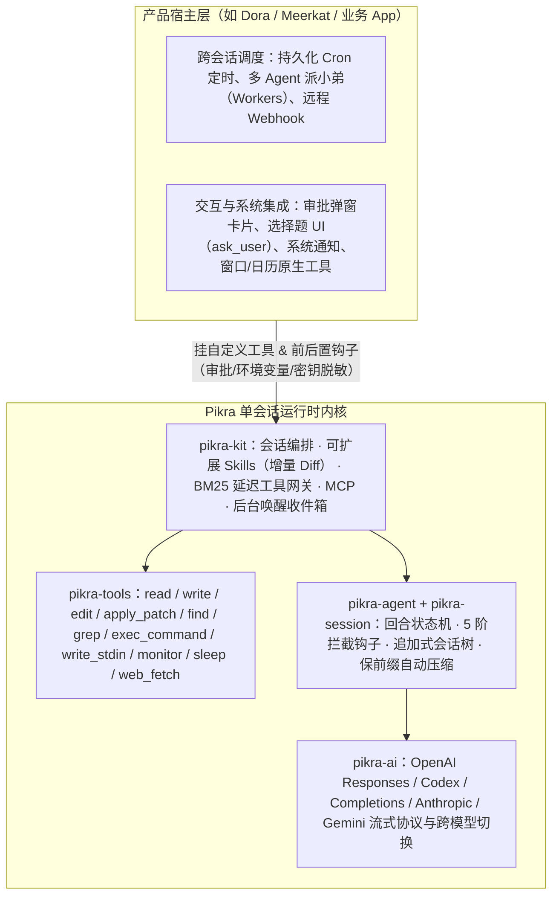
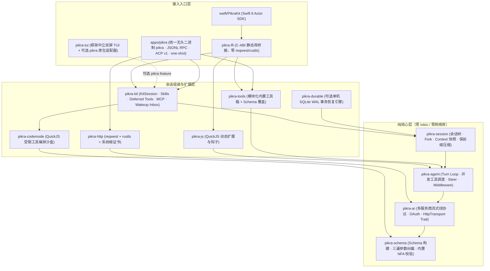

# Pikra 架构与设计边界

> **一句话定位**：用 Rust 编写的超轻量、模块化、Prompt Cache 友好的无头（Headless）Agent 运行时内核，配齐产品级单源内置工具箱、可扩展 Skills 与动态工具体系，原生提供 Rust Crate、Swift 6 SDK（`PikraKit`）与跨语言 JSONL RPC（`pikra --mode rpc`）。

---

## 1. 核心设计哲学

### 1.1 为什么既有「极简微内核」又有「产品级内置工具箱」？
像 `pi` 这类编程向框架内核极轻，但内置工具过于简陋（只有同步 `bash` 和基础读写，缺 `rg` 全文检索、后台长驻终端、`Monitor` 事件唤醒、网页正文提纯与可扩展 Skill 目录），直接拿去做产品时每个宿主都得重造一遍轮子。

Pikra 采用**「微内核分层 + 单源可裁剪工具包」**架构同时解决这两个矛盾：
- **核心层极度纯粹**：`pikra-schema`、`pikra-ai`、`pikra-agent`、`pikra-session` 零磁盘子进程依赖、零网络库绑定，任何沙盒环境（含 iOS、边缘运行时）均可嵌入。
- **产品级工具单源实现、按需裁剪**：`pikra-tools` 在 Rust 内统一实现一套工业级工作区工具（内嵌 `ripgrep` 的 `find`/`grep`、Codex 同款 4 级容错 `apply_patch`/`edit`、带 PTY 的前后台 `exec_command`/`write_stdin`、按行防抖与防刷屏的 `monitor`、可提前打断的 `sleep`、移植自 Defuddle 的 `web_fetch`）。Rust 端靠 Cargo Features 裁剪，预编译 SDK（如 Swift `.xcframework`）靠独立 C 构造入口配合链接器 `-dead_strip` 自动剔除未选工具的重型依赖，彻底终结「每种语言 SDK 各抄一遍工具」的维护灾难。

### 1.2 单会话引擎 vs 多 Agent 产品宿主的分工边界
Pikra 严格守住**单会话运行时**边界，不与上层产品宿主（如 Dora、Meerkat）抢调度权：

---

## 2. Workspace 包拓扑与职责

---

`pikra-tui` 默认零 `pikra-*` 依赖，由四层组成。`engine` 提供主题、流式 Markdown、输入器和终端原语。`harness` 定义 `TuiHarness` 及其可选能力。`ui` 渲染对话滚屏、输入框和弹窗。`app` 管理鼠标和键盘输入、全屏与行内切换、终端恢复及 OSC 7501 状态。启用 `feature = "pikra"` 后激活 `pikra_tui::pikra` 原生直连 `KitSession`（零 ACP 序列化）。iOS 与 Swift FFI 保持完全隔离。

## 3. 四大关键架构机制

### 3.1 双轨网络抽象（`HttpTransport`）
- **Linux / Windows / CLI / 服务端**：直接注入 `pikra-http::ReqwestTransport`（纯 Rust `reqwest` + `rustls` + 操作系统原生根证书库），单文件静态分发，完美避开 Linux OpenSSL 版本冲突与 Windows WinHTTP 流式缺陷，同时兼容企业内网根证书与系统代理。
- **macOS / iOS 原生 App（`PikraKit`）**：`pikra-ffi` 不打包任何网络或 TLS 库，由 Swift 侧无痕 `URLSession` 实现同一套 `HttpTransport`。不仅省掉双份 TLS 体积，还能天然支持 iOS 联网权限弹窗、VPN 分流工具按应用规则代理以及 `web_fetch` 零额外依赖联网。
- **网页访问策略**：`pikra-tools` 为每次页面请求和每一跳重定向检查 DNS 和地址范围。符合公网域名规则的名称可以解析到 `198.18.0.0/15` TUN Fake-IP。ACP 复用这套检查，用标准权限请求批准指定来源的本地访问。链路本地地址始终拦截。本地主机名解析到 IPv6 链路本地地址和其他可用地址时，只用可用地址继续。

### 3.2 Prompt Cache 绝对前缀保护
所有动态能力均围绕「已发送前缀字节恒定」设计：
1. **常驻与延迟严格分池**：顶层 `tools` 数组在会话建立时锁定顺序；外部 MCP 工具或超预算工具自动进入 `DeferredToolRegistry`，通过常驻的 `tool_search`（BM25 分词相关性排序）按需拉取参数定义，通过 `call_tool` 执行（事件流自动透出内部真实工具名供 UI 展示）或在 `exec`（QuickJS 沙盒）中批量编排。
2. **无品牌硬编码的 `AGENTS.md` 与 Skills 多级发现**：
   - 库层只内置中立规范（`.agents/skills`、`~/.agents`、`AGENTS.override.md` > `AGENTS.md`），零 `.pikra` 写死路径，所有自定义目录、回溯边界（`ProjectRoot` 停 `.git` / `FilesystemRoot` 爬到 `/` / `CurrentDirOnly`）与指令体积上限（默认指令 `32 KiB` 可设 `None`）均交由宿主覆盖；多份正文完全一致的 `AGENTS.md` 自动去重不重复加载；所有可见 Skills 全量渲染进 `<available_skills>`（不截断、不做路径别名压缩）。
   - **首轮与压缩后保真，中途自动热加载且只发增删 Diff**：`AGENTS.md` 走具名上下文块，压缩后自动保留防遗忘；`Skills` 默认在每轮对话前自动重扫并在桌面端通过可选跨平台 `SkillWatcher` 实时监听（兼容软链与尚未创建的 Skill 目录），会话运行中若新增、删除、移动或重指向软链 Skill，只在末尾追加 `# Skills changed` 增量块，原地修改已有 `SKILL.md` 正文静默不刷屏。
3. **压缩复用父前缀**：自动压缩摘要请求直接复用上一轮完整消息与工具前缀，仅在尾部追加摘要指令，最大化命中缓存读取。

### 3.3 前后台统一终端、`Monitor` 事件唤醒与 `Sleep`
告别低效耗费 Token 的轮询等待：
- **`exec_command` + `write_stdin`**：短命令在 `yield_time_ms` 内跑完直接返回输出；长耗时服务或构建自动转入会话后台池返回 `session_id`，支持真 PTY 交互输入、增量读输出与进程组级强制回收。
- **`monitor` + 会话唤醒收件箱**：在后台监听命令标准输出（200ms 防抖合并成批，stderr 仅落盘日志，1 分钟超 200 行自动触发防刷屏熔断）。当 Agent 处于空闲态时，收件箱将到达的后台事件合并为单条 `<monitor_event>` 消息自动唤醒新一轮推理（或转交重宿主自己的调度器）；当 Agent 正在执行 `sleep` 时，新消息或 `monitor` 事件会立即提前打断休眠。

### 3.4 宿主拦截切面与工具 Schema 自定义
宿主无需重写内置工具代码即可完成产品化定制：
- **定义层覆盖（`ToolDefinitionOverride`）**：挂载内置工具时可改工具名（如把 `exec_command` 暴露为 `bash`）、替换或追加工具描述文案、隐藏指定可选参数并注入固定默认值。
- **执行层切面（`AgentMiddleware` / SDK Hooks）**：`before_tool_call` 统一拦截权限审批与参数改写；`env_provider` 动态注入终端环境变量；`after_tool_call` 统一对输出中的敏感密钥打码脱敏或落盘截断。

### 3.5 通用隐藏上下文原语（`is_meta` / `isMeta`）
宿主在注入系统提醒、后台事件唤醒或中途协议纠偏时，无需靠正则过滤 `<system-reminder>` 标签：
- **底层统一标记**：`UserMessage` 原生携带 `is_meta: bool`（Swift / JSON 兼容 `isMeta`），向模型发请求时完全等同于标准 `user` 消息（不向任何上游模型 API 泄露额外字段，100% 保持缓存前缀字节一致），而对 UI 历史与实时事件天然区分用户发言与系统注入。
- **全时机覆盖**：所有 `<system-reminder>`（`set_context` / `append_context` / `append_named_context`）、无标签隐藏块（`append_meta`）、自动压缩摘要、后台 `Monitor` 唤醒轮次、独立触发的隐藏轮次（`prompt_meta` / `submit_meta`）以及运行中隐藏插话（`steer_meta` / `follow_up_meta`，不触发面向用户的 `Steered` 气泡事件）均统一标记 `is_meta: true`，`visible_messages()` 与 ACP 历史回放自动过滤。
