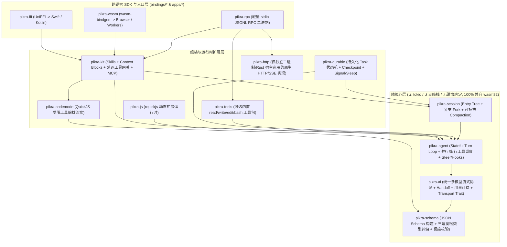
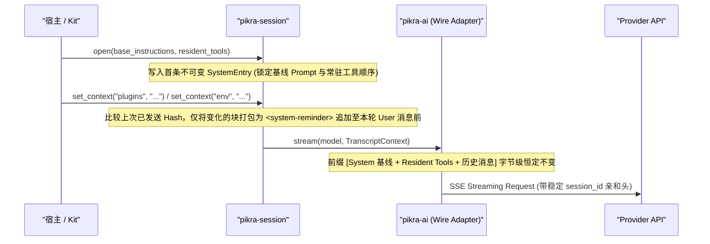

# Pikra 架构设计文档

> **定位**：面向全端嵌入（Swift / Kotlin / Wasm / Rust / Node / RPC）的超轻量、模块化、零隐式副作用的无头（Headless）Agent 引擎。
> **仓库路径**：`/path/to/pikra`

---

## 1. 设计目标与硬指标

1. **极致体积与零宿主冗余**：核心库不绑死 `tokio`、不内置 TLS/HTTP 协议栈、不带任何 TUI 代码。宿主嵌入（Swift/Kotlin）直接复用系统网络栈，单架构二进制增量控制在 **1.2MB ~ 1.8MB**（对比 `fx` + `LibFx` 的 ~9.8MB 缩减 80% 以上）；纯 `agent + ai` Wasm 产物 gzip 后 **< 400KB**。
2. **包级彻底解耦**：对标 [pi](https://github.com/badlogic/pi-mono)，从 `schema`、`ai`、`agent`、`session`、`durable`、`codemode` 到 `kit` 严格单向依赖，每一层均可作为独立库单独引入，未引入的包物理零编译。
3. **全链路免改源码扩展**：关键生命周期全部暴露为可组合拦截点。同进程宿主可直接用宿主语言（Swift/Kotlin/Rust/TS）注入原生 Hook 与 Tool；跨端动态能力通过可选的 `pikra-js`（`rquickjs`）实现脚本级扩展与 `codemode` 工具编排沙盒。
4. **Prompt Cache 一等公民**：对齐 **Pi**（`TranscriptContext`）、**Claude Code**（锁定 `cache_control` + `<system-reminder>` 尾部追加）与 **Codex (`codex-rs`)**（`contextual_user_message` 增量上下文片段）的生产级机制，杜绝热更新工具、Skill 或环境信息时打断服务端缓存前缀。

---

## 2. Cargo Workspace 包拆分与依赖拓扑

整个仓库维护单一根 `Cargo.toml`（Rust Edition 2024），按职责拆分为以下独立 Crate：



### 各包职责与独立可用性边界

| Crate | 对标 `pi` 模块 | 核心职责 | 外部依赖约束 |
| :--- | :--- | :--- | :--- |
| **`pikra-schema`** | `pi-schema` | 工具参数 JSON Schema 定义、LLM 松散输出三遍纠偏（去可选 `null`、`String` 转数值/布尔、单值包数组、`anyOf` 分支匹配）与模型友好的单行错误诊断 | 仅 `serde`、`serde_json` |
| **`pikra-ai`** | `pi-ai` | 统一流式协议（`openai-responses`、`openai-completions`、`anthropic-messages`、`google-generative-ai`）、SSE 帧解析、Thinking 签名保留、跨模型消息 Handoff、Token/Cost 核算 | 仅 `pikra-schema`、`futures-core`；HTTP 由 `HttpTransport` trait 注入 |
| **`pikra-agent`** | `pi-agent-core` | 纯内存 Agent Turn 状态机：`prepareRequest` → 流式生成 → 参数校验与 `beforeToolCall` → 并行/串行工具执行 → `afterToolCall` → `finishTurn`，含 `steer` 插话与 `followUp` 队列 | 仅 `pikra-ai`；零磁盘/系统调用 |
| **`pikra-session`** | `SessionManager` | 追加式不可变会话树（`SessionEntry` 带 `id`/`parentId`）、分支 `fork`、上下文重建、Prompt Cache 安全上下文块去重、可插拔 `CompactionStrategy` | 仅 `pikra-agent`；内置 `MemoryStore` 与 `JsonlStore` trait |
| **`pikra-durable`** | `pi-durable` | 事务型持久化执行引擎：原子 Commit、崩溃自动续跑（Task Phase Checkpoint）、幂等 `requestId`、`sleepUntil` 与外部 `Signal` 唤醒（二阶段演进） | `pikra-agent` + `pikra-session` + SQLite/KV 后端 |
| **`pikra-codemode`** | `pi-codemode` | 模型编写的受限 async JS 工具编排沙盒：仅暴露注入的 `tools.*`、`ALL_TOOLS`、`text()`、`image()`、`store/load`，嵌套调用不进 LLM 上下文。可脱离 Agent 单独使用 | Native 用 `rquickjs`（无 JIT）；Wasm 走宿主 `ScriptBridge` |
| **`pikra-js`** | `extensions` (JS) | 使用 `rquickjs` 加载跨平台 `.js` 扩展脚本，注册自定义工具与回合/工具级拦截钩子 | `pikra-agent` + `rquickjs` |
| **`pikra-kit`** | `pi-coding-agent` (无 TUI) + `pi-mcp` | 开箱即用门面：组装 `Session` + `Skill` 按需发现 + 动态 `<system-reminder>` 上下文块 + 延迟工具加载（`tool_search` / `call_tool`）+ MCP Client（Streamable HTTP / stdio） | 按 Cargo Feature 开关子模块 |
| **`pikra-tools`** | coding-agent builtin tools | 可选本地系统工具（`read`、`write`、`edit`、`bash`、`find`），工具命名与参数对齐统一词汇表 | 仅桌面/CLI 按需引入，移动端/Wasm 不引入 |
| **`pikra-rpc`** | `pi --mode rpc` | 独立无头子进程二进制：严格 LF 分隔的 `stdin/stdout` JSONL 命令、响应与流式事件协议 | 组装 `pikra-kit` + `pikra-http` + `pikra-tools` |

---

## 3. 核心机制设计

### 3.1 I/O 与异步运行时解耦（为什么能既小又跨全端）

核心层（`schema` / `ai` / `agent` / `session` / `kit`）使用标准 Rust `async fn` + `futures_core::Stream`，**不直接调用 `tokio::spawn` 或特定网络库**，仅通过两个极简宿主接口与外部世界交互：

```rust
/// 1. 字节流 HTTP 传输抽象：Swift 接 URLSession，Kotlin 接 OkHttp，Wasm 接 fetch，CLI 接 pikra-http
pub trait HttpTransport: Send + Sync {
    fn send(&self, req: HttpRequest, abort: AbortRegistration) -> BoxFuture<'_, Result<HttpStreamResponse, TransportError>>;
}

/// 2. 并发派发器（仅并行工具执行需要）：单线程 Wasm 用 spawn_local，Swift/Kotlin/Tokio 桥接各自任务池
pub trait Spawner: Send + Sync {
    fn spawn(&self, fut: BoxFuture<'static, ()>);
}
```

> [!IMPORTANT]
> 这套设计直接消除了两大痛点：一是宿主 App 无需打包双份 TLS/HTTP 栈（省掉 `rustls`/`ring` 数百 KB 体积）；二是自动继承宿主系统的网络环境（macOS/iOS 系统代理、企业根证书、HTTP/3 连接复用）。

---

### 3.2 `pikra-ai`：转录上下文与 Prompt Cache 前缀保护

融合 **Pi**（`TranscriptContext` / `SystemMessage`）、**Claude Code**（`ToolSearchTool` / `SkillTool` 通过 `<system-reminder>` 注入与相邻块合并）以及 **Codex (`codex-rs`)**（`contextual_user_message` 追加环境状态）的成熟做法，模型请求采用**严格的追加式转录模型**：



1. **基线不可变**：会话建立时写入首条 `SystemMessage`（包含基础指令与按固定顺序排列的常驻工具定义），会话存活期内绝不重排工具顺序或重写头部。
2. **动态上下文增量追加**：环境信息、插件列表、MCP/延迟工具目录变化统一通过 `Session::set_context(name, text)` 管理。内核记录每个 `name` 最后发出的内容摘要，未变化不重发；变化时在两轮之间合并成 `<system-reminder>` 消息追加在末尾。
3. **压缩复用前缀**：触发上下文压缩（Compaction）时，生成摘要的请求**原样携带当前完整历史前缀**并在末尾追加一条摘要指令请求，从而直接命中最后一轮的 Prompt Cache Read（省去全价重算整段上下文的成本）；压缩完成后生成新 `CompactionEntry`，并在下一轮自动补发当前生效的上下文块。
4. **跨模型无损 Handoff**：`AssistantMessage` 完整保留各家专有元数据（Anthropic `thinkingSignature` / `redacted`、OpenAI Responses `item_id` / `phase`、Gemini `thoughtSignature`）。会话中途切换模型/服务商时，适配器自动将异构签名降级为标准文本/思考块，同服务商内保留原生重放签名，避免 400 校验错误。

---

### 3.3 `pikra-agent` + 双层扩展体系（不改源码定制一切）

Agent 回合状态机在单次运行内严格按以下管线流转，每个控制点均可通过 **Middleware Stack（洋葱模型 / 责任链）** 挂载多个扩展：


**统一的 `Extension` 契约支持两种注入方式无缝混用**：

1. **宿主原生扩展（零 JS 开销，全端可用）**
   - Rust 宿主直接实现 `Extension` / `AgentTool` trait；
   - Swift / Kotlin / Wasm 宿主通过 FFI Callback Interface 直接用 Swift Closure/Protocol、Kotlin Interface 或 JS 函数注册自定义工具和拦截器。
2. **QuickJS 动态扩展（`pikra-js`，可选挂载）**
   - 仅在控制面节点（`prepare_request`、`transform_context`、`before_tool_call`、`after_tool_call`、`finish_turn`、`compact`）调用 QuickJS，**流式高频 `text_delta` / `thinking_delta` 绝不跨 JS 边界**。
   - 支持从目录或内存加载 `.js` 模块调用 `pikra.registerTool(...)` 与 `pikra.on(...)`，支持运行时 `reload()`，一套脚本跨 macOS / iOS / Android / CLI 通用。

---

### 3.4 延迟工具网关与 `pikra-codemode`

针对嵌入宿主往往有数十上百个业务 Action / MCP 工具的场景，在 `pikra-kit` 层内置两套省 Token 利器：

1. **延迟工具检索（`tool_search` + `call_tool`）**：常驻工具表只放高频基础工具与 `tool_search` / `call_tool`（工具列表保持固定不破前缀缓存）；其余工具仅以极简名称索引通过 `deferred_tools` 上下文块告知模型，模型按需 `tool_search` 拉取完整 JSON Schema。
2. **Code Mode 工具编排（`pikra-codemode`）**：将所有可用工具注入受限 QuickJS 沙盒（禁绝网络、文件系统、定时器，配额限制内存如 `32MB` 及执行超时中断）。模型一次性写出多步逻辑：
   ```js
   const items = await tools.list_todos({ status: "open" });
   for (const item of items.slice(0, 5)) {
     await tools.mark_reviewed({ id: item.id });
   }
   text(`Processed ${Math.min(items.length, 5)} items`);
   ```
   中间 6 次工具调用全部在沙盒与宿主间闭环，**不产生 6 轮模型推理，也不膨胀会话上下文**。

---

## 4. 多语言 SDK 封装方案

拒绝手搓脆弱的 C 字符串消息总线，针对不同平台提供最地道的原生绑定：

| 目标生态 | 绑定技术 | 产物形态 | 宿主接入体验 |
| :--- | :--- | :--- | :--- |
| **Swift (macOS / iOS)** | `UniFFI` + 极薄 Swift 扩展层 | `PikraCore.xcframework` + Swift Package (`PikraKit` / `PikraAI`) | 原生 `async throws`、`AsyncStream<AgentEvent>`、Swift `protocol` 注入 `URLSession` Transport 与自定义工具；零 `Yams` / `JSONSchema.swift` 外部依赖 |
| **Kotlin (Android / JVM)** | `UniFFI` + 极薄 Coroutines 封装 | AAR / JAR (`dev.what1f.pikra`) | 原生 `suspend fun`、`Flow<AgentEvent>`、`sealed interface` 事件匹配、桥接 `OkHttp` |
| **Wasm (Browser / Edge)** | `wasm-bindgen` | npm `@what1f/pikra-wasm` | 零拷贝桥接 `globalThis.fetch` 与 `ReadableStream`，支持 Cloudflare Workers / 浏览器沙盒 |
| **Rust (`meerkat` 等)** | 原生 Cargo Crates | 直接引用 `pikra-ai` / `pikra-agent` / `pikra-kit` | 零 FFI 损耗，直接进程内嵌入，替代 `meerkat-agent` 子进程黑盒 |
| **跨进程通用 (`RPC`)** | `pikra-rpc` 二进制 | 单文件静态可执行程序（`pikra --mode rpc`） | 严格 LF 分隔的 `stdin` 命令 / `stdout` 事件流（兼容 `pi` RPC 语义：带 `id` 请求关联、`prompt` / `steer` / `abort` / `agent_settled`） |

---

## 5. 编译配置与体积控制规范

在根 `Cargo.toml` 固化体积优先配置，并在 CI/本地脚本设立体积红线检查：

- **Release 构建配置**：`opt-level = "z"`（或分 profile 对比 `"s"`）、`lto = true`、`codegen-units = 1`、`panic = "abort"`、`strip = "symbols"`。
- **依赖禁令**：
  - 核心包禁止引入 `regex`（普通通配与简单格式校验手写字节扫描，省 ~600KB Unicode 表）、禁止引入 `chrono`（时间戳统一用 `u64` Unix ms）、禁止在核心包开启 `tokio/full`。
  - 模型目录（Catalog）采用紧凑静态表或宿主按需注册（类似 `pi-ai` 的按 Provider Factory 注册），不把几百个冷门模型元数据硬塞进默认二进制。

---

## 6. 测试规范与首版演进切片

严格执行**零单元测试、只写极简核心业务 E2E** 原则：
- 源码 `src/` 下**禁止写 `#[cfg(test)]` 单元测试**，不测内部私有函数，不用 `sleep` 做任何时序等待。
- 建立独立的 `crates/pikra-testkit`：内置确定性的 **Faux Streaming Provider**（模拟真实 SSE 分块吐字、Thinking 块、并行工具调用、网络中断、Usage 回报，并自动记录每次实际发出的序列化 Payload 以断言 **Prompt Cache 前缀字节级未破坏**）。
- 每个模块仅维护 1~3 条端到端业务闭环测试；真实模型联调通过环境变量显式开启。

### 分阶段交付路线图

1. **Slice 1（底座闭环：`schema` + `ai` + `agent`）**
   - 跑通 JSON Schema 三遍纠偏校验、`openai-responses` / `openai-completions` / `anthropic-messages` / `google-generative-ai` 四大流式协议、Agent Turn Loop（含并发工具保序、`steer` 插话、全链路原生 Hooks）及前缀稳定性 E2E 验证。
2. **Slice 2（会话与组装：`session` + `kit` + `rpc`）**
   - 跑通追加式会话树、分支 `fork`、保前缀缓存的 `<system-reminder>` 上下文块与自动 Compaction、延迟工具（`tool_search` / `call_tool`）、Skill 加载、MCP Client 与 `pikra-rpc` JSONL 协议。
3. **Slice 3（QuickJS 能力：`codemode` + `js`）**
   - 落地 `rquickjs` 受限工具编排沙盒与 `.js` 动态扩展热加载。
4. **Slice 4（跨语言 SDK：`Swift` + `Wasm` + `Kotlin`）**
   - 打通 `pikra-ffi`（生成 `PikraKit` Swift Package 并实测单架构二进制体积）与 `pikra-wasm`（跑通浏览器/Workers 流式调用），达到生产级嵌入标准。

---

## 7. 代码体量预算与工期评估（对照 `pi` 实测非空 LOC）

基于 `earendil-works/pi` 各包真实源码行数（排除生成表、单测、TUI、CLI 安装器及冷门长尾适配器）折算：

| 模块 | `pi` 源码实测 (TS) | `pikra` 预估 (Rust) | 裁剪与折算说明 |
| :--- | ---: | ---: | :--- |
| **`pikra-schema`** | 4,307 行 | **1,200 ~ 1,600 行** | 省去 TS `Static` 类型体操层，保留核心 JSON Schema 校验 + 三遍 Coercion |
| **`pikra-ai`** (+ `http`) | 26,309 行 | **4,800 ~ 6,500 行** | 首版聚焦 4 大核心协议（Responses / Completions / Anthropic / Gemini，在 `pi` 中合计 ~6,600 行）+ 跨模型 Handoff + SSE/计费；砍掉 ~1.8 万行冷门云厂商/图像/分类器胶水 |
| **`pikra-agent`** | 2,315 行 | **2,200 ~ 2,800 行** | 1:1 复刻状态机、并发保序工具执行、`steer`/`followUp` 与全套拦截 Hook |
| **`pikra-session`** | 3,322 行 | **2,000 ~ 2,500 行** | 对标 `session-manager.ts` (1,847) + `compaction/` (1,475) |
| **`pikra-kit`** (+ `mcp`) | ~8,500 行 | **2,500 ~ 3,200 行** | 保留 Skills、`tool_search`、上下文片段、Streamable HTTP/stdio MCP；剔除 CLI 包管理与 HTML 导出 |
| **`pikra-tools`** + **`rpc`** | ~6,200 行 | **2,000 ~ 2,800 行** | 可选本地文件/Shell 工具集 + 严格 LF JSONL RPC 二进制 |
| **`pikra-codemode`** + **`js`** | 2,855 行 | **1,800 ~ 2,500 行** | 直接绑定原生 `rquickjs`，省去 Node Worker / WASI 胶水层 |
| **多语言 SDK 层** (`ffi`/`wasm`/Swift/Kotlin) | — | **2,000 ~ 2,800 行** | UniFFI 导出定义 + Swift `URLSession`/`AsyncStream` + Kotlin `OkHttp`/`Flow` + Wasm `fetch` |
| **首版产品代码合计** | — | **18,500 ~ 24,700 行** | 另加 `pikra-testkit` 与核心 E2E 约 **3,000 ~ 4,000 行** |
| **二期 `pikra-durable`**（独立演进） | 33,630 行 | **+4,500 ~ 6,500 行** | 剥离 `chord` 分布式对象框架，仅做单库原子事务 + Task Checkpoint + Signal/Sleep |

